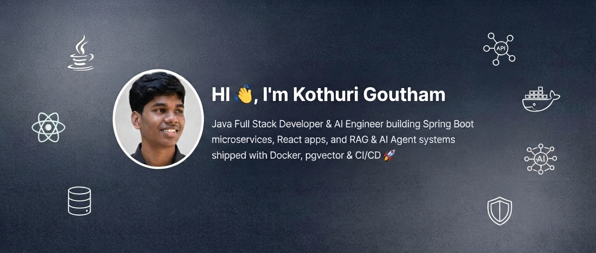

<!-- Save as README.md in a PUBLIC repo named exactly: kothurigoutham
     Also upload the banner image to that repo as: assets/banner.jpg -->

 

---

## About me

I'm a **Java Full Stack Developer**. I build Spring Boot services, React front ends, RAG pipelines, and AI-powered applications, focusing on production-ready solutions through clean REST APIs, event-driven architecture with Kafka, containers, and CI/CD
- **B.Tech in Information Technology** at CBIT, Hyderabad (2025 to 2028)

## Core stack

**Java and Spring Boot**

`Java 17/21` `Spring Boot` `Spring Security` `Spring Data JPA` `Hibernate` `Microservices` `REST APIs` `Apache Kafka` `JWT and RBAC`

**AI agents and RAG**

**Also working with**

## Featured projects

<table>
  <tr>
    <td width="50%" valign="top">
      <h3><a href="https://github.com/kothurigoutham/Spring-Vector-AI">Enterprise RAG Document Q&amp;A</a></h3>
      Semantic search and contextual Q&amp;A over multi-page documents. A Spring Boot ingestion engine chunks PDFs with Apache PDFBox and stores embeddings in PostgreSQL with pgvector. The React UI streams tokens in real time with source citations.
        
      
      
      
      
    </td>
    <td width="50%" valign="top">
      <h3><a href="https://github.com/kothurigoutham/smart-fridge-project">SmartFridge AI</a></h3>
      AI-driven kitchen system aligned with UN SDGs to cut household food waste. Uses multi-zone computer vision for item tracking and autonomous agent workflows to estimate shelf life, predict expiry and suggest recipes. REST APIs connect the Python inference service to a React dashboard.
        
      
      
      
    </td>
  </tr>
  <tr>
    <td width="50%" valign="top">
      <h3><a href="https://github.com/kothurigoutham/springboot-react-jwt-token">JWT Auth &amp; RBAC Platform</a></h3>
      Full-stack authentication with stateless JWT, refresh tokens, token blacklisting and granular role-based access control. Spring Security and Spring Data JPA on MySQL, with a React client that uses route guards.
        
      
      
      
    </td>
    <td width="50%" valign="top">
      <h3><a href="https://github.com/kothurigoutham/spring-boot-ai">Spring Boot AI Agent (MCP &amp; RAG)</a></h3>
      AI agent built with Spring AI that books accommodation in tourist cities. Uses the Chat Client API with advisors for RAG and chat memory, a local weather tool and a remote booking tool over the Model Context Protocol, and runs on Ollama, Google Gemini or AWS Bedrock through Spring profiles.
       Based on the open-source sample by <a href="https://github.com/rogervinas/spring-boot-ai">rogervinas</a>.
        
      
      
      
      
    </td>
  </tr>
</table>

## 💼 Internship Experience

### 1. JPMorgan Chase – Software Engineering Virtual Experience
- **Platform:** Forage
- **Domain:** Software Engineering
- **Technologies & Skills:** Java, Spring Boot, Apache Kafka, Maven, Backend Development, REST APIs, Event-Driven Architecture.
- Worked on practical software engineering tasks simulating real-world development workflows at JPMorgan Chase.

### 2. AI for Sustainability Virtual Internship
- **Platform:** National Internship Portal (AICTE)
- **Program Partner:** 1M1B
- **Supported by:** AICTE & IBM SkillsBuild
- **Domain:** Artificial Intelligence & Sustainability
- **Skills:** Artificial Intelligence, Responsible AI, Agentic AI, Retrieval-Augmented Generation (RAG), Sustainability, and UN Sustainable Development Goals (SDGs).
- Explored AI-driven solutions, responsible AI practices, and applications of Agentic AI and RAG for sustainability challenges.

## Certifications

